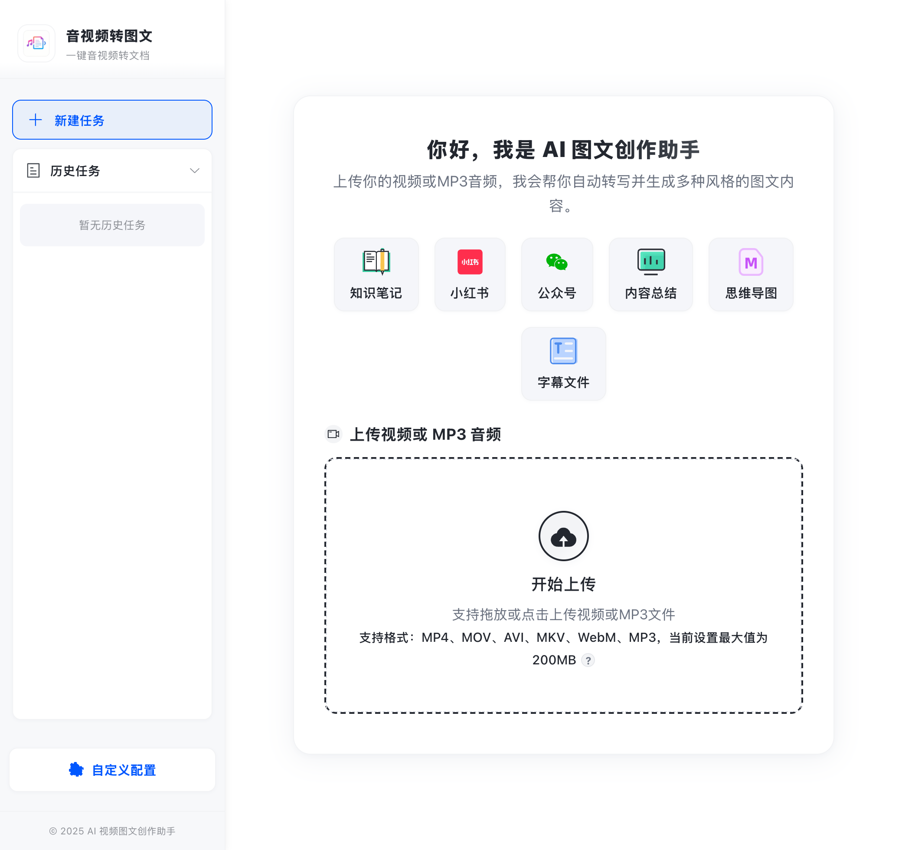

# 音视频转图文（AI-Media2Doc）

> 篝火出品 · 收录于篝火 App 应用区 · 基于开源项目 [hanshuaikang/AI-Media2Doc](https://github.com/hanshuaikang/AI-Media2Doc)（MIT）

把录屏、课程、访谈等视频或音频，一键转成小红书 / 公众号 / 知识笔记 / 思维导图 / 内容总结等风格的图文文档，还能导出字幕、针对内容继续问答、按字幕智能截图插入文章。在自己的电脑或服务器上用 Docker 部署，网页操作，界面本来就是中文，不需要切换语言。

<p align="center"></p>

## 先看清楚：需要准备哪些账号（缺一不可）

上游不是纯本地工具，转写依赖云服务：

| 需要 | 用途 | 说明 |
|---|---|---|
| **火山引擎账号 + "录音文件识别"应用** | 语音转文字 | 上游代码固定调用火山引擎的录音文件识别接口，**没有别的选项**。需要在控制台创建应用，得到 `AUC_APP_ID`、`AUC_ACCESS_TOKEN`、`AUC_CLUSTER_ID`（注意是"语音识别 → 录音文件识别"，不是"录音文件识别大模型"）。上游称试用有 20 小时额度，之后的计费以火山引擎为准 |
| **兼容 S3 协议的对象存储** | 暂存音频：浏览器上传到这里，语音识别服务再从这里下载 | 上游教程用的是火山引擎 TOS，也可换其他兼容 S3 的服务；需要建好存储桶，并设置**跨域（CORS）规则**允许浏览器上传。需要地址、区域、桶名、访问密钥 |
| **大模型接口** | 生成文档 | 兼容 OpenAI 格式的接口即可。地址、密钥、模型名都由你自己填，本工具不内置任何服务商 |

音频会上传到你自己的对象存储，并交给火山引擎识别，**不是纯离线**；文本内容会发给你填的大模型接口。

## 部署（需要装好 Docker 的电脑或服务器）

```bash
mkdir media-to-article && cd media-to-article
# 下载 Releases 里的 docker-compose.yml 和 .env.example
cp .env.example .env     # 编辑 .env，填写上面三类服务的信息
docker compose up -d
```

浏览器打开 `http://127.0.0.1:8080`。

- 镜像：`ghcr.io/campfire-code/media-to-article:latest`，支持 x86 与 ARM。前端和后端合并在一个镜像里，只用 8080 一个端口。
- 默认只监听本机。要给局域网或外网使用，把 `docker-compose.yml` 里端口的 `127.0.0.1:` 去掉，**务必同时设置 `.env` 里的 `WEB_ACCESS_PASSWORD`**（再在网页"自定义设置 → 访问密码"里填同样的密码），并放在 HTTPS 反向代理之后；否则任何人都能花你的额度。
- 视频先在浏览器里用 ffmpeg（wasm）抽出音频再上传，不需要在服务器装 ffmpeg；大文件会比较吃浏览器内存。
- 任务记录保存在浏览器本地。

## 怎么用

1. 打开网页，界面是中文的。先在上方选一种文档风格（知识笔记、小红书、公众号、内容总结、思维导图、字幕文件），再把视频或 MP3 音频拖进虚线框，或点「开始上传」选文件。
2. 等待上传、识别、生成；完成后可以查看图文、导出字幕、继续向 AI 提问。
3. "自定义设置"里可以开启智能截图、修改提示词、填写访问密码。

## 验收用例

| 操作 | 应得到 |
|---|---|
| `docker compose up -d` 后访问 `http://127.0.0.1:8080/health` | 返回 200，JSON 里 status 为 healthy |
| 浏览器打开 `http://127.0.0.1:8080/` | 看到中文首页 |
| 填好三类服务后，上传一段 1 分钟的中文音频，选"内容总结" | 几分钟内得到 Markdown 文档，并能导出字幕 |
| 设置了 `WEB_ACCESS_PASSWORD` 后，不填密码直接发请求 | 返回 401 |

## 和上游的区别

- 把前后端合并成一个镜像（`docker/Dockerfile.campfire`）：前端构建为静态文件，由后端同端口提供，并带上 ffmpeg wasm 所需的跨源隔离响应头（`backend/app.py`）。
- 大模型接口默认地址由上游的火山方舟改为通用的 `https://api.openai.com/v1`（`backend/env.py`、`variables_template.env`），模型名需要自己填。
- 侧栏标题由英文名改为「音视频转图文」，上传区标题中的「Mp3」统一写成「MP3」（`frontend/src/components/AppSidebar.vue`、`UploadSection.vue`）。
- 前端接口地址配置改为"空字符串表示同源"（`frontend/src/config.js`）。
- 新增 `campfire/` 部署文件、`tool.json`、篝火发布流程；删除上游的 Docker Hub 发布工作流。

## 归属与许可证

上游项目版权归原作者所有，按 MIT 许可证分发，全文见 [LICENSE](LICENSE)。上游 README 中的赞助、公众号等信息属于原作者，原文保留在下方。

---

以下为上游 README 原文。

---

<h1 align="center">
  <p>
  
    </p>
</h1>

<p align="center">
    <a href="https://hellogithub.com/repository/d869461d98d245d388b50e25b6a80dae" target="_blank"></a>
</p>

<p align="center">
  <a href="./LICENSE"></a>
  
  
</p>


### 📖 简介

AI 视频图文创作助手是一款 Web 工具, 基于 AI 大模型, 一键将视频和音频转化为各种风格的文档, 无需登录注册, 前后端本地部署，以极低的成本体验 AI 视频/音频转风格文档服务。


### ✨ 核心功能

- ✅ **完全开源**：MIT 协议授权，支持本地部署。
- 🔒 **隐私保护**：无需登录注册，任务记录保存在本地
- 💻 **前端处理**：采用 ffmpeg wasm 技术，无需本地安装 ffmpeg
- 🎯 **多种风格支持**：支持小红书/公众号/知识笔记/思维导图/内容总结等多种文档风格支持。
- 🤖 **AI 对话**：支持针对视频内容进行 AI 二次问答。
- 🎬 **支持字幕导出**: 结果一键导出为字幕文件。
- 🖼️ **智能截图**: 基于字幕信息智能截图并插入文章, 无需视觉大模型, 实现真正的图文并茂。
- 🎨 **支持自定义 Prompt**：支持在前端自定义配置 prompt。
- 🐳 **一键部署**：支持 Docker 一键部署。
- 🔒 **支持设置访问密码**: 后端设置访问密码之后, 前端用户需要填写该密码才可以正常使用。


### 🔜 未来计划
- 🎙️ 音频识别支持使用 fast-whisper 本地大模型处理，进一步降低成本

### 👾 开发者的废话

AI 视频创作助手源于我年初的一个想法, 作为一个喜欢阅读的人, 我更希望将一些视频内容转化为文字, 方便我进行二次阅读思考和总结记录笔记, 但市面上并没有一个好的工具来实现这个想法, 大多数工具都需要登录和付费, 我不太想在互联网上注册过多的账号, 同时也不想将自己想要总结的内容上传至除了云厂商之外的第三方平台，因此我开发了这个小应用，MIT 协议, 任何人都可以以极低的成本去体验音视频转文本。

### 💬 哪里可以找到我
公众号(韩数同学)
<p align="left">
    
</p>

或者首页置顶 issue 加入微信交流群. 如果部署遇到问题，我下班之后看到后一般会回复。


### 项目截图

#### 全新设计的首页, 尽力之作

<p align="center">
    
</p>

#### 全新功能: 支持智能截图并插入到文中对应位置(本地方案, 无需视觉大模型, 0成本)

开启方式, 点击自定义设置->智能截图 选择打开。

<p align="center">

</p>

#### 全新设计的结果页, 支持一键导出为字幕。
<p align="center">

</p>

#### 支持自定义 prompt
<p align="center">

</p>


### 📦 docker 本地一键部署
0️⃣：安装 `docker`, 这个网上有教程, Windows 玩家建议使用 `wsl` 启动该项目。

1️⃣：下载项目首页的 docker-compose.yaml 文件

2️⃣：参考`variables_template.env` 在项目根目录下生成 `variables.env` 文件。 请根据 [后端部署指引 / 配置项说明](https://github.com/hanshuaikang/AI-Media2Doc/blob/main/backend/README.md#%E5%9C%A8%E7%81%AB%E5%B1%B1%E5%BC%95%E6%93%8E%E8%8E%B7%E5%8F%96%E5%AF%B9%E5%BA%94%E7%9A%84%E7%8E%AF%E5%A2%83%E5%8F%98%E9%87%8F%E7%9A%84%E5%80%BC) 完善 `variables.env` 文件中的环境变量。
variables.env 必须与 docker-compose.yaml 在同一目录下, 建议建个新的文件夹单独存放这两个文件。

3️⃣：运行, 在 docker-compose.yaml 所在目录下运行:

```shell
$ docker-compose -f docker-compose.yaml up -d
```


### 🔧 本地开发指南

- [后端本地部署](./backend/README.md)
- [前端本地部署](./frontend/README.md)


### 🤝 赞助

<table>
  <thead>
    <tr>
      <th align="center" style="width: 150px;">
        <a href="https://skywork.ai/p/mvVidS"><br>
          <sub>天工超级智能体 1.0</sub><br>
          <sub>调用海量工具完成各种任务</sub>
        </a>
      </th>
    </tr>
  </thead>
</table>


### 🔄 处理流程

<p align="center">

</p>

### 🌵 支持开发者
你可以关注我的小红书:

[韩数同学： 致力于分享 Github 上那些好玩、有趣、免费、实用的高质量项目](https://www.xiaohongshu.com/user/profile/5e2992b000000000010064a4)

微信公众号: **韩数同学**

**或者请我吃一包辣条** , 作为一个超级喜欢吃辣条的人, 很多晚上维护开源项目都是边吃辣条边写代码的 🤪。如果你有很喜欢吃的辣条, 你可以投喂我吃一包辣条, 5毛一包的也可以, 我将直接开启代码狂暴模式(化身八爪鱼: 🐙)。

请留下你要赞助作者的辣条名称 (🤩❤️‍🔥): 支持卫龙/麻辣王子/博士牛筋/臭干子，禁止投喂(🥵😵😵‍💫🤧🥴): **缺牙齿**/**霸王丝**等有损本人生命值的辣条。

同时请备注你的 github 名称, 方便我整理展示在项目主页。🙌

<p align="left">
 赞助作者: <a href="https://afdian.com/a/hanshu-github">我的爱发电主页</a>
</p>

[赞助名单](./docs/sponsors.md)

### 🙌 致谢
感谢这些朋友对本项目做出的贡献:

|  |  |                                                                                                                        |
|:-:|:-:|:----------------------------------------------------------------------------------------------------------------------:|
| <a href="https://github.com/ZhuoZhuoCrayon"><br/>crayon</a> | <a href="https://github.com/cjx929"><br/>chen_jx</a> | <a href="https://github.com/LMseventeen"><br/>LMseventeen</a>  |

感谢以下自媒体对本项目的关注和转发(以下排名不分先后), 大家感兴趣的话可以关注下他们 ～

| [HelloGithub](https://hellogithub.com)   |                           开源AI项目落地                            |                               [阮一峰的网络日志](https://www.ruanyifeng.com/blog/weekly/)                               |                               一飞开源                               |                             胖氪笔记                              |                          逛逛Github                            |                    小红书: 摸鱼的小李                            |
|:----:|:-------------------------------------------------------------:|:---------------------------------------------------------------------------------------------------------------:|:------------------------------------------------------------:|:-------------------------------------------------------------:|:------------------------------------------------------------:|:------------------------------------------------------------:|
|| | |  |   |  |  

小红书:
[AI-GitHub](https://www.xiaohongshu.com/user/profile/65c44d1200000000090254fc) | [逛逛Github](https://www.xiaohongshu.com/user/profile/65e05165000000000500b059)


推特:
| [Geek](https://x.com/geekbb) | [AIGCLINK](https://x.com/aigclink) | [ilovelife](https://x.com/ilovek8s) | [ahhhhfs](https://x.com/abskoop)

### 📄 许可证

本项目采用 [MIT 许可证](./LICENSE)

### 🔗 相关链接

- [volcengine-ai-app-lab](https://github.com/volcengine/ai-app-lab)

- [throttled-py](https://github.com/ZhuoZhuoCrayon/throttled-py)：✨Python 限流库，合理限制、平滑云资源用量。

### 其他 AI 工具:
[Owl 猫头鹰小红书/公众号敏感词检测工具](https://owl.hanshutx.com/): 支持小红书、公众号敏感词检测，提交检测后自动识别文本中的敏感词并高亮显示，避免笔记违规, 免费使用。

### 🌟 Star History

[](https://www.star-history.com/#hanshuaikang/AI-Media2Doc&Date)
